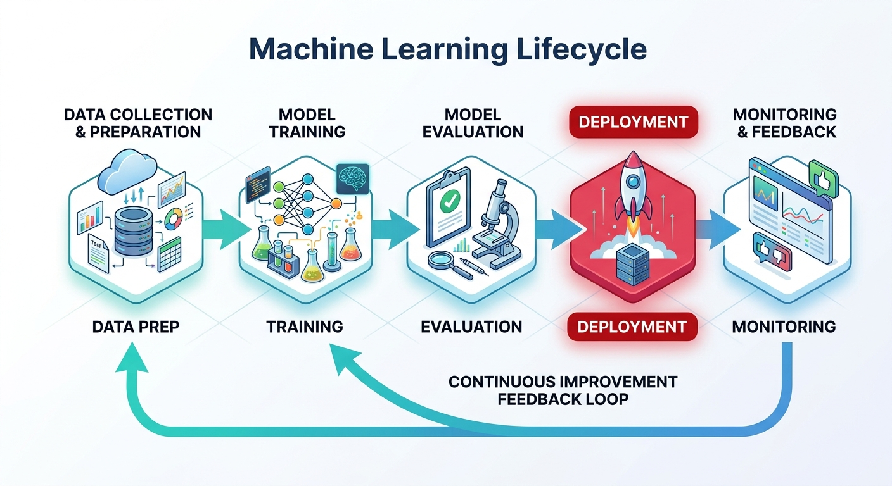

# What is ML Model Deployment?

## The ML Lifecycle



. . .

::: {.callout-note}
**Deployment** is the process of making a trained model accessible to users or systems — it's where ML delivers business value.
:::

## Why Deployment is Hard

::: {.incremental}
- 🖥️ **Environment mismatch** — "Works on my machine" syndrome
- 📦 **Dependency hell** — Library versions, Python versions
- ⚡ **Scalability** — Handling 1 user vs. 1 million users
- 🔄 **Model drift** — Data distributions change over time
- 🔐 **Security** — Exposing models creates attack surfaces
- 📉 **Latency** — Real-time vs. batch inference tradeoffs
:::

# Core Deployment Patterns 

## Deployment Strategy Comparison

| Pattern | Latency | Throughput | Use Case |
|---------|---------|------------|----------|
| **REST API** | Low | Medium | Real-time predictions |
| **Batch Inference** | High | Very High | Overnight scoring |
| **Streaming** | Very Low | High | Event-driven systems |
| **Edge Deployment** | Ultra-Low | Low | Mobile/IoT |

## Imagine you have trained an Iris classification model.

- **REST API:** A website sends four flower measurements to your FastAPI /predict endpoint and receives a prediction.

- **Batch inference:** You have 100,000 flowers in a CSV file and want to classify them all in one run.

- **Streaming:** A sensor continuously produces measurements, and you want to classify each incoming event.

- **Edge deployment:** A mobile application runs the model directly on the phone, even when internet connectivity is unavailable.

# Model Serialization {background-color="#533483"}

## Serialization Options Compared

```python
import joblib
import pickle
import json
from sklearn.ensemble import RandomForestClassifier
import numpy as np

# Train a simple model
from sklearn.datasets import load_iris
X, y = load_iris(return_X_y=True)
model = RandomForestClassifier(n_estimators=100, random_state=42)
model.fit(X, y)
```

## Joblib vs Pickle vs ONNX

::: {.panel-tabset}

### Joblib (Recommended)
```python
# Save
joblib.dump(model, "model.pkl")
joblib.dump(model, "model.pkl.gz", compress=3)  # compressed

# Load
loaded_model = joblib.load("model.pkl")
pred = loaded_model.predict([[5.1, 3.5, 1.4, 0.2]])
```

### Pickle
```python
import pickle

# Save
with open("model.pkl", "wb") as f:
    pickle.dump(model, f)

# Load
with open("model.pkl", "rb") as f:
    loaded_model = pickle.load(f)

# ⚠️ Security risk: never unpickle untrusted data!
```

### ONNX (Cross-platform)
```python
from skl2onnx import convert_sklearn
from skl2onnx.common.data_types import FloatTensorType
import onnxruntime as rt

# Convert
initial_type = [("float_input", FloatTensorType([None, 4]))]
onnx_model = convert_sklearn(model, initial_types=initial_type)

# Save
with open("model.onnx", "wb") as f:
    f.write(onnx_model.SerializeToString())

# Inference (no sklearn needed!)
sess = rt.InferenceSession("model.onnx")
pred = sess.run(None, {"float_input": X[:5].astype(np.float32)})
```

:::

## REST API Deployment with FastAPI {auto-animate=true}

```python
# app.py
from fastapi import FastAPI
from pydantic import BaseModel
import joblib
import numpy as np

app = FastAPI(title="Iris Classifier API", version="1.0")

# Load model at startup (not per-request!)
model = joblib.load("iris_model.pkl")

class PredictionRequest(BaseModel):
    sepal_length: float
    sepal_width: float
    petal_length: float
    petal_width: float

class PredictionResponse(BaseModel):
    prediction: int
    class_name: str
    confidence: float
```

## REST API Deployment with FastAPI {auto-animate=true}

```python
CLASSES = ["setosa", "versicolor", "virginica"]

@app.get("/health")
def health_check():
    return {"status": "ok"}

@app.post("/predict", response_model=PredictionResponse)
def predict(request: PredictionRequest):
    features = np.array([[
        request.sepal_length,
        request.sepal_width,
        request.petal_length,
        request.petal_width
    ]])
    
    pred = model.predict(features)[0]
    proba = model.predict_proba(features)[0]
    
    return PredictionResponse(
        prediction=int(pred),
        class_name=CLASSES[pred],
        confidence=round(float(proba[pred]), 4)
    )
```

## Run It Locally

```bash
# Install dependencies
pip install fastapi uvicorn scikit-learn joblib

# Start the server
uvicorn app:app --host 0.0.0.0 --port 8000 --reload

# Test it
curl -X POST "http://localhost:8000/predict" \
  -H "Content-Type: application/json" \
  -d '{"sepal_length": 5.1, "sepal_width": 3.5,
       "petal_length": 1.4, "petal_width": 0.2}'
```

::: {.callout-tip}
FastAPI auto-generates interactive docs at `http://localhost:8000/docs` — great for testing!
:::


# Containerization with Docker

## Why Docker?

::: {.columns}

::: {.column width="50%"}
**The Problem**

```
Dev machine:
  Python 3.10
  scikit-learn 1.3.0
  numpy 1.24.0

Production server:
  Python 3.8
  scikit-learn 1.0.2
  numpy 1.22.0
  
💥 Prediction mismatch!
```
:::

::: {.column width="50%"}
**The Solution**

```
Docker container:
  Frozen environment
  Python 3.10 ✓
  scikit-learn 1.3.0 ✓
  numpy 1.24.0 ✓
  
🎉 Same everywhere!
```
:::

:::

## Writing a Dockerfile

```dockerfile
# Dockerfile
FROM python:3.11-slim

# Set working directory
WORKDIR /app

# Install dependencies first (layer caching!)
COPY requirements.txt .
RUN pip install --no-cache-dir -r requirements.txt

# Copy application code
COPY app.py .
COPY iris_model.pkl .

# Expose port
EXPOSE 8000

# Health check
HEALTHCHECK --interval=30s --timeout=3s \
  CMD curl -f http://localhost:8000/health || exit 1

# Start the app
CMD ["uvicorn", "app:app", "--host", "0.0.0.0", "--port", "8000"]
```

## Docker Workflow

```bash
# Build the image
docker build -t iris-classifier:v1 .

# Run the container
docker run -d \
  --name iris-api \
  -p 8000:8000 \
  iris-classifier:v1

# Check it's running
docker ps
docker logs iris-api

# Push to a registry
docker tag iris-classifier:v1 myregistry/iris-classifier:v1
docker push myregistry/iris-classifier:v1
```

::: {.callout-warning}
**Never** store model weights or secrets in your Docker image for production. Use environment variables or mounted volumes.
:::


# Model Versioning & Tracking

## MLflow: Track Everything

```python
import mlflow
import mlflow.sklearn
from sklearn.ensemble import RandomForestClassifier
from sklearn.metrics import accuracy_score, f1_score
from sklearn.datasets import load_iris
from sklearn.model_selection import train_test_split

mlflow.set_experiment("iris-classifier")

with mlflow.start_run(run_name="rf-v1"):
    X, y = load_iris(return_X_y=True)
    X_train, X_test, y_train, y_test = train_test_split(
        X, y, test_size=0.2, random_state=42
    )
    
    # Log parameters
    params = {"n_estimators": 100, "max_depth": 5}
    mlflow.log_params(params)
    
    # Train
    model = RandomForestClassifier(**params, random_state=42)
    model.fit(X_train, y_train)
    
    # Log metrics
    preds = model.predict(X_test)
    mlflow.log_metric("accuracy", accuracy_score(y_test, preds))
    mlflow.log_metric("f1_score", f1_score(y_test, preds, average="macro"))
    
    # Log model   
    mlflow.sklearn.log_model(
    sk_model=model,
    name="model",
    registered_model_name="IrisClassifier",
    skops_trusted_types=["sklearn.tree._tree.Tree"]
)
```

## Model Registry Workflow

```bash
# Start MLflow UI
mlflow ui --port 5000

# View at http://localhost:5000
```

```python
# Load a specific version from the registry
import mlflow.pyfunc

# Load by version number
model_v1 = mlflow.pyfunc.load_model("models:/IrisClassifier/1")

# Load by stage (Staging, Production)
prod_model = mlflow.pyfunc.load_model("models:/IrisClassifier/Production")

# Make predictions
predictions = prod_model.predict(X_test)
```

::: {.callout-note}
MLflow tracks **what** was trained, **when**, with **what data**, and **how well** it performed.
:::

# Monitoring in Production

## What to Monitor {background-color="#1a1a2e"}

```{mermaid}
mindmap
  root((Monitoring))
    Infrastructure
      CPU / Memory
      Request latency
      Error rate
    Data Quality
      Missing values
      Out-of-range inputs
      Schema violations
    Model Performance
      Prediction drift
      Confidence scores
      Label distribution
    Business Metrics
      Conversion rate
      Revenue impact
      User satisfaction
```

## Logging Predictions for Monitoring

```python
import logging
import json
from datetime import datetime
from fastapi import FastAPI, Request
import time

app = FastAPI()
logger = logging.getLogger("ml_api")

@app.middleware("http")
async def log_requests(request: Request, call_next):
    start_time = time.time()
    response = await call_next(request)
    duration = time.time() - start_time
    
    logger.info(json.dumps({
        "timestamp": datetime.utcnow().isoformat(),
        "path": request.url.path,
        "method": request.method,
        "status_code": response.status_code,
        "duration_ms": round(duration * 1000, 2)
    }))
    return response

@app.post("/predict")
def predict(request: PredictionRequest):
    features = [request.sepal_length, request.sepal_width,
                request.petal_length, request.petal_width]
    pred = model.predict([features])[0]
    confidence = float(model.predict_proba([features])[0].max())
    
    # Log for drift detection
    logger.info(json.dumps({
        "event": "prediction",
        "input": features,
        "output": int(pred),
        "confidence": confidence,
        "timestamp": datetime.utcnow().isoformat()
    }))
    
    return {"prediction": int(pred), "confidence": confidence}
```

## Detecting Data Drift

```python
from evidently.report import Report
from evidently.metrics import DataDriftPreset
import pandas as pd

# Reference data (training distribution)
reference_data = pd.read_csv("training_data.csv")

# Current production data (last 7 days of inputs)
current_data = pd.read_csv("production_logs_last_7d.csv")

# Generate drift report
report = Report(metrics=[DataDriftPreset()])
snapshot=report.run(
    reference_data=reference_data[feature_cols],
    current_data=current_data[feature_cols]
)

# Save HTML report
snapshot.save_html("drift_report.html")

# Check programmatically
result = snapshot.as_dict()
drift_detected = result["metrics"][0]["result"]["dataset_drift"]

if drift_detected:
    send_alert("⚠️ Data drift detected! Consider retraining.")
```

# Cloud Deployment Options

## Deployment Landscape

::: {.columns}

::: {.column width="33%"}
**Managed ML Platforms**

- AWS SageMaker
- Google Vertex AI  
- Azure ML
- Databricks

*Best for: Teams with cloud budgets, enterprise scale*
:::

::: {.column width="33%"}
**Container Platforms**

- AWS ECS / EKS
- Google Cloud Run
- Azure Container Apps
- Kubernetes

*Best for: Custom control, microservices*
:::

::: {.column width="33%"}
**Serverless**

- AWS Lambda
- Google Cloud Functions
- Azure Functions
- Hugging Face Spaces

*Best for: Low traffic, cost-sensitive*
:::

:::

# Class Activity {background-color="#e94560"}

## Build & Deploy your Model

::: {.callout-important}
## Activity Overview
Work in pairs to deploy a real ML model from previous Labs as a REST API. You'll train, serialize, serve, and test it — end to end.
:::

---

## Activity Steps {.smaller}

::: {.panel-tabset}

### Step 1: Train (5 min)
```python
# train_model.py
from sklearn.datasets import load_wine
from sklearn.ensemble import GradientBoostingClassifier
from sklearn.model_selection import train_test_split
from sklearn.preprocessing import StandardScaler
from sklearn.pipeline import Pipeline
from sklearn.metrics import classification_report
import joblib

X, y = load_wine(return_X_y=True, as_frame=True)
X_train, X_test, y_train, y_test = train_test_split(
    X, y, test_size=0.2, random_state=42)

pipeline = Pipeline([
    ("scaler", StandardScaler()),
    ("model", GradientBoostingClassifier(n_estimators=50))
])

pipeline.fit(X_train, y_train)
preds = pipeline.predict(X_test)
print(classification_report(y_test, preds))

joblib.dump(pipeline, "wine_model.pkl")
print(" Model saved to wine_model.pkl")
```

### Step 2: Serve (10 min)
```python
# serve.py
from fastapi import FastAPI, HTTPException
from pydantic import BaseModel, Field
import joblib
import numpy as np

app = FastAPI(title="Wine Quality Classifier")
model = joblib.load("wine_model.pkl")

WINE_CLASSES = {0: "Class 0", 1: "Class 1", 2: "Class 2"}

class WineFeatures(BaseModel):
    alcohol: float = Field(..., example=13.2, ge=10.0, le=15.5)
    malic_acid: float = Field(..., example=1.78, ge=0.5, le=6.0)
    ash: float = Field(..., example=2.14, ge=1.0, le=4.0)
    alcalinity_of_ash: float = Field(..., example=11.2, ge=10.0, le=30.0)
    magnesium: float = Field(..., example=100.0, ge=70.0, le=165.0)
    total_phenols: float = Field(..., example=2.65, ge=0.5, le=4.0)
    flavanoids: float = Field(..., example=2.76, ge=0.0, le=6.0)
    nonflavanoid_phenols: float = Field(..., example=0.26, ge=0.0, le=1.0)
    proanthocyanins: float = Field(..., example=1.28, ge=0.0, le=4.0)
    color_intensity: float = Field(..., example=4.38, ge=1.0, le=15.0)
    hue: float = Field(..., example=1.05, ge=0.5, le=2.0)
    od280_od315: float = Field(..., example=3.40, ge=1.0, le=5.0)
    proline: float = Field(..., example=1050.0, ge=300.0, le=2000.0)

@app.get("/health")
def health(): return {"status": "ok"}

@app.post("/predict")
def predict(wine: WineFeatures):
    features = np.array([[getattr(wine, f) for f in wine.model_fields]])
    pred = int(model.predict(features)[0])
    proba = model.predict_proba(features)[0]
    return {
        "predicted_class": pred,
        "class_name": WINE_CLASSES[pred],
        "probabilities": {WINE_CLASSES[i]: round(float(p), 4)
                          for i, p in enumerate(proba)}
    }
```

### Step 3: Test (10 min)
```bash
# In terminal 1: Start the server
pip install fastapi uvicorn
uvicorn serve:app --reload --port 8000

# In terminal 2: Test the API

# Health check
curl http://localhost:8000/health

# Make a prediction
curl -X POST http://localhost:8000/predict \
  -H "Content-Type: application/json" \
  -d '{
    "alcohol": 13.2, "malic_acid": 1.78, "ash": 2.14,
    "alcalinity_of_ash": 11.2, "magnesium": 100.0,
    "total_phenols": 2.65, "flavanoids": 2.76,
    "nonflavanoid_phenols": 0.26, "proanthocyanins": 1.28,
    "color_intensity": 4.38, "hue": 1.05,
    "od280_od315": 3.40, "proline": 1050.0
  }'

# Open interactive docs in browser
open http://localhost:8000/docs
```

### Step 4: Extend (5 min)
```python
# Challenge: Add these to your serve.py

# 1. Input validation with better error messages
from fastapi import HTTPException

@app.post("/predict")
def predict(wine: WineFeatures):
    try:
        features = np.array([[getattr(wine, f) for f in wine.model_fields]])
        pred = int(model.predict(features)[0])
        proba = model.predict_proba(features)[0]
        confidence = float(proba[pred])
        
        # Challenge A: Refuse low-confidence predictions
        if confidence < 0.60:
            raise HTTPException(
                status_code=422,
                detail=f"Model confidence too low: {confidence:.0%}"
            )
        
        return {"predicted_class": pred, "confidence": confidence}
    except Exception as e:
        raise HTTPException(status_code=500, detail=str(e))

# Challenge B: Add a /batch endpoint that accepts a list of wines
# Challenge C: Add request timing to every response
```

:::

# Key Takeaways

## What We Covered

::: {.columns}

::: {.column width="50%"}
**Technical Skills**

-  Serving models with FastAPI
-  Containerizing with Docker
-  Serializing models (joblib / ONNX)
-  Tracking experiments with MLflow
-  Monitoring drift in production
:::

::: {.column width="50%"}
**Mental Models**

- Deployment ≠ just copying files
- Production requires a feedback loop
- Containers solve environment problems
- You must monitor what you deploy
- Version everything: code, data, models
:::

:::

## The Deployment Checklist

Before you ship a model to production:

```markdown
## Pre-deployment Checklist

- [ ] Model serialized and version-tagged
- [ ] API tested with valid and invalid inputs  
- [ ] Docker image builds successfully
- [ ] Health check endpoint works
- [ ] Latency measured and acceptable (p99 < SLA)
- [ ] Logging captures inputs, outputs, latency
- [ ] Drift detection baseline established
- [ ] Rollback plan documented
- [ ] Load test passed
- [ ] Secrets managed via env vars (not hardcoded!)
```
